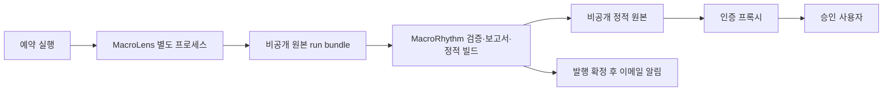

# 개발·운영 구조 — R0 제안

확정: 초기 네 지표, 월요일 09:00 Asia/Seoul 발행 목표, 개인·승인 사용자 접근,
월 추가 운영비 10,000원 이내 상한 목표, PC·스마트폰 대응입니다.
v1은 R0~R5로 실제 자료 자동 갱신·정기 발행까지 포함합니다. R0에서는 설계만 하고 실행하지 않습니다.
섹터 점수/순위는 v1 제품에서 제외하며 R6는 M4 검증 뒤 별도 승인하는 선택 확장입니다.
아래 서비스와 시각·보관·재시도는 기술 제안이며 아직 채택/배포하지 않았습니다.

## 1. 정적 사이트 적합성

주 1회 갱신·소수 사용자·읽기 중심이므로 Python으로 HTML/JSON을 사전 생성하는 방식이 적합합니다.
원문의 화면 범위는 홈(`/`), 지표 상세(`/indicators/<id>`), 주간 고정 보고서(`/reports/YYYY-MM-DD`),
아카이브(`/reports`), 관리자 전용 상태(`/status`)입니다. R2에서 PC·모바일 가독성, 터치·키보드 탐색,
차트 대체 텍스트를 검수합니다. 원자료/변환/표준화 요인을 구분하고 신규 관측·수정·무변동·보류를 표시합니다.
초기에는 DB·상주 API·프런트엔드 프레임워크가 필수가 아닙니다. 차트 라이브러리는 후속 단계에서
라이선스·접근성·번들 크기를 검토해 선택하며 외부 CDN 의존 없이 배포 자산에 포함하는 것을 제안합니다.
정적 파일은 변경 이력과 이전 발행본을 검토하기 쉽고 배포/복구 비용도 작습니다.

다만 정적 사이트 자체는 사용자를 인증하지 않습니다. **정적 생성 + 인증 프록시 + 비공개 원본**이
권장 구조입니다. 사용자별 데이터/쓰기·실시간 질의·권한별 화면이 필요하면 backend 설계를 다시 평가합니다.
Python 웹서버와 웹 UI는 R0에서 만들지 않았습니다.

원본 bundle은 웹 root와 분리합니다. 브라우저에는 승인된 최소 표시 필드만 제공합니다.
향후 HTML 생성은 텍스트 escape, Markdown/출처 URL 검증, 외부 script 제한/CSP를 포함해야 합니다.
신뢰하지 않는 Markdown의 raw HTML/script를 허용하지 않습니다.

## 2. 데이터 갱신·발행·이메일 순서

발행 목표는 **월요일 09:00 Asia/Seoul = 월요일 00:00 UTC**입니다. 한국시간은 DST가 없습니다.
미국 현지 발표시각과는 별개이며 미국 휴일·월별 지표의 무변동도 정상적으로 표시합니다.

운영 시각 제안(미확정):

1. 월요일 08:20 KST부터 producer 갱신/수신 준비. UTC cron으로는 일요일 `20 23 * * 0`.
   실제 FRED 수집은 MacroLens 측에서만 수행하고 데이터 키도 그 실행 환경에만 둡니다.
2. 08:40 KST 자료 마감 후보. 수신 완료된 immutable run을 골라 계약·해시·상태 검증.
   현재 수집에는 미래 as_of를 강제하지 않습니다. 실제 수집/기준 시각과 자료 cutoff를 각각 남깁니다.
3. 검증된 데이터로 HTML·차트 데이터·주간 보고서 후보 생성. 같은 주/모델의 발행 잠금을 획득.
4. 09:00 KST 이후 승인된 후보를 원자적으로 발행하고 read-back 검증 후 알림 큐에 기록.
   발행용 UTC cron은 `0 0 * * 1`. runner가 일찍 시작해도 시간 gate로 조기 게시하지 않음.
5. 이메일에는 발행 시각·자료 기준·보류/지연 여부와 **로그인이 필요한 링크** 위주로 안내.
   승인 사용자 명단/개인 데이터/원본 JSON은 첨부하지 않음.

예약 runner 예: private GitHub Actions. 예약 지연·실행 누락이 가능하고 정시 SLA를 보장하지 않습니다.
특히 정각 부하가 있으므로 09:00은 목표 시각이며 정확한 시각 보장이 필요하면 별도 scheduler/예산 검토가 필요합니다.
기본 브랜치 워크플로 조건·비활성 예약 중지·private 사용량/보존 제한은 실제 선택 시 확인합니다.
R0에는 예약 YAML이나 배포/메일 코드를 추가하지 않았습니다.

실패·중복 방지 제안:

- 제한 재시도(예: 최대 3회, backoff), 같은 run/보고서 revision 발행·알림의 멱등 키 사용.
- 검증 실패/업스트림 held 시 무효 지표의 수치·비교를 만들어내지 않음. 최신 시도 상태와 마지막 정상본을 함께 표시.
  held 자체의 상태 보고서를 낼지는 사용자 정책으로 확정하되 정상 갱신 보고서로 가장하지 않음.
- 목표시각을 넘기면 지연 표시·운영자 통지, 완료 후 실제 발행 시각 기록. 늦은 재시도를 정시 성공으로 기록하지 않음.
- 이메일 실패가 이미 검증된 웹 발행을 되돌리지는 않음. outbox로 실패 수신자만 재시도하고 중복 발송 방지.
- 원본 run, 교환 envelope, report revision, 렌더러/커밋, 전달·발행·메일 상태를 서로 연결.
  정정판은 supersedes 관계로 남기고 기존 주간 보고서를 덮어쓰지 않음.

보고서 설명은 지표 원자료·변환값·전주 비교와 한계의 결정론적 한국어 템플릿을 우선 제안합니다.
v1에서는 섹터 점수·순위·섹터 기여도를 설명 입력으로 쓰지 않습니다. AI API는 필수가 아니며
R0에서 도입하지 않았습니다. 지표의 수치 변화를 경제적 인과나 수익률 예측으로 과장하지 않습니다.

## 3. 접근 제한과 개인정보

원문의 우선 제안은 **Cloudflare Workers Static Assets + Access**, 보고서 렌더링은 Python + Jinja2입니다.
R0에서는 이를 도입/가입/배포하지 않았으며 실제 production·origin 보호/무료 조건을 검증한 뒤 선택합니다.
Cloudflare Pages는 우선 후보를 바꾸는 결정이 아니라 접근통제 우회 가능성을 점검할 비교 사례입니다.
Access 같은 identity-aware proxy 앞의 비공개 정적 원본이 필요하며 운영자와 조회 전용 사용자를 분리합니다.
GitHub Pages의 일반 공개 배포나 private Git 저장소만으로 사이트 접근 제한을 달성했다고 볼 수 없습니다.
고급 요금제의 private publishing을 전제하지 않습니다.

배포 전에 필요한 검수:

- 승인 계정 allowlist(실제 명단은 비공개 설정), 기본 deny, 세션 만료·로그아웃·권한 회수.
- production/custom 도메인, 기본 hosting 도메인, preview, 파일 원본/object URL 전부 동일 보호.
  preview만 인증되는 구성을 production 인증으로 오인하지 않음. 직접 origin 우회는 차단.
- HTML뿐 아니라 JSON·JS에 포함된 데이터·보고서·첨부·과거 버전·검색 색인·에러 응답도 보호.
- 비인증/미승인 요청이 민감 본문 없이 401/403 또는 인증 화면으로 가는지 테스트.
- 인증 전 응답과 개인화 응답의 캐시 누출 방지, 인증 헤더 제거 방지, private/no-store 정책 검토.
- 로그인용 외부 서비스가 있어도 사용자 이메일/토큰을 공개 빌드 자산에 포함하지 않음.
- 발신 이메일은 별도 수신 동의·수신 거부·반송 처리. BCC 또는 수신자별 발송으로 주소 노출 방지.

메일 제공자 토큰은 발송 job에만, 저장소 간 토큰은 읽기 대상에만, 배포 토큰은 해당 사이트에만 한정합니다.
발송 도메인의 SPF/DKIM/DMARC·발신자 검증, Access 인증 수단, 관리자 복구 절차는 선택 후 설정합니다.
데이터 게시 전 FRED 및 개별 제공자의 재배포/저작권 조건을 확인하고 출처를 보존합니다.
KIS 자료는 초기 미사용이며 별도 약관 검토 없이 웹으로 제공하지 않습니다.
실제 이메일 주소/키는 이 저장소나 예제에 넣지 않습니다. 원시 예외·요청 URL·키가 로그에 남지 않게 합니다.

## 4. 운영비 — 목표와 미확정 사항

월 10,000원은 **목표 예산**이며 확보된 서비스 견적이 아닙니다. 아래는 무료 조건을 충족하는
소규모 사용량을 가정한 예산 배분안입니다. 현재 요금/상업 이용/인원/트래픽 제한은 실계정에서 확인하지 않았습니다.
무료 서비스는 유료 전환을 자동 허용하지 않고 한도 근접 알림과 지출 상한을 설정하는 것을 제안합니다.

| 항목 | 월 예산 배분 후보 | 무료 이용의 제약·확인 사항 |
| --- | ---: | --- |
| 예약 실행·Python 빌드 | 0원 목표 | private Actions 포함 실행시간·저장량·runner 종류·동시 실행·정시 보장 없음 |
| 정적 호스팅·접근 프록시 | 0원 목표 | 무료 인증 사용자 수·IdP·production/origin 보호·대역폭·빌드/함수 한도 |
| 비공개 bundle/보고서 보관 | 0~2,000원 | Actions artifact 보관 만료/총량 또는 object storage 요청/용량/egress 과금 |
| 알림 이메일 | 0~1,000원 | 무료 수신/발송 대상·일/월 한도·발신 도메인·반송/스팸·운영 용도 허용 |
| 선택적 도메인 연간 비용의 월 환산 | 0~3,000원 | 도메인 미구매 시 0; 갱신가·부가세·서비스가 자체 도메인을 요구하는지 |
| 환율·세금·초과 사용 예비비 | 4,000원 | 유료 사용은 합계 10,000원 이내 확인 후 허용 |

위 배분의 상단 합계는 월 10,000원입니다. 주 1회 약 4~5회 실행, 작은 정적 자산,
소수 승인 사용자, 소량 메일을 가정합니다. 도메인·유료 메일·외부 서비스의 실제 비용을 모두 합산합니다. 실제 원본 관측 bundle 크기와 보관 기간이 비용을 좌우합니다.
인증 서비스의 최소 유료 요금이 예산을 넘으면 해당 조합은 채택하지 않습니다.
무료 도메인을 쓰더라도 인증 우회 차단이나 메일 발신에 별도 도메인이 필요할 수 있습니다.

선택 전 공식 확인처(참고 링크이며 이번에 최신 요금 검증/서비스 가입하지 않음):

- [GitHub Actions billing](https://docs.github.com/en/billing/managing-billing-for-your-products/managing-billing-for-github-actions/about-billing-for-github-actions)
- [GitHub scheduled events](https://docs.github.com/en/actions/reference/workflows-and-actions/events-that-trigger-workflows#schedule)
- [Cloudflare Zero Trust plans](https://www.cloudflare.com/plans/zero-trust-services/)
- [Workers Static Assets](https://developers.cloudflare.com/workers/static-assets/)
- [Workers와 Access](https://developers.cloudflare.com/workers/configuration/cloudflare-access/)
- [Pages Access 문서](https://developers.cloudflare.com/pages/configuration/preview-deployments/#customize-preview-deployments-access)
- [Cloudflare R2 pricing](https://developers.cloudflare.com/r2/pricing/)
- [Resend pricing](https://resend.com/pricing) — 이메일 후보 예시, 선정 아님

## 5. 보존·복구·개발 환경

제안 기본값: 발행한 주간 보고서·사용한 정규화 입력·계약/버전은 장기 보존,
raw 응답/임시 실패 실행은 제한 보존(기간·비용은 미확정). Actions artifact만을 영구 저장으로 사용하지 않습니다.
삭제/만료 전 원본 manifest를 포함해 별도 비공개 백업하고 복원 후 무결성과 과거 보고서 재생성을 검증합니다.
권한 설정·배포 설정은 비밀을 분리해 기록하고 토큰 회전·사용자 철회 절차도 운영 인수에 포함합니다.

현재 개발은 Python/uv의 로컬 테스트·패키징만 필요합니다. DB·FRED/KIS·SMTP·외부 계정 없이
R0 테스트를 실행할 수 있습니다. 현 단계는 CLI/서버 실행이나 웹 배포 성공을 의미하지 않습니다.

## 6. v1 인수 검수 — R5까지

원문 기준으로 연속 **4회** 주간 생성/발행 시나리오를 기록합니다. 모의/과거 시나리오로 선시험할 수
있으며 실제 4주 경과를 필수로 요구하지 않습니다. 정상·실패·중복 실행을 포함해 다음을 검수합니다.

- 네 지표의 원자료/변환값이 MacroLens 표본과 일치, 시각·단위·신규/수정/무변동/보류를 구분.
- PC/스마트폰에서 홈·상세·보고서·아카이브를 읽을 수 있고 차트 대체 텍스트/기본 접근성 확보.
- 생산·기본 hosting(`workers.dev` 등)·preview·JSON·과거 보고서의 비인가 접근 직접 차단 시험.
- 실제 발행 시각, 수동 실행/재발행, 메일 동의·중복 방지·실패 기록/재시도 검수.
- 백업 복원과 과거판 불변, 비밀/개인정보 비노출, 실제 추가 월비용 합산 10,000원 이하 확인.

이 항목들은 R0 완료 결과가 아니라 R1~R5의 후속 완료 기준입니다. R6로 미루지 않습니다.

## 7. 사용자 결정이 필요한 항목

1. 승인 사용자 수/인증 수단, 기본·preview 도메인까지 보호 가능한 호스팅 조합.
2. 09:00 정시의 허용 지연, 08:40 cutoff 제안, held일 때 상태 보고서/메일 발행 여부.
3. MacroLens 실행 버전/담당, 비공개 산출물 전달처·보존 기간·저장소 간 권한(섹터 점수 표시는 v1 제외).
4. 도메인·메일 등 실비를 합산한 월 10,000원 상한 내 서비스 조합, 세금/환율 여유 및 유료 초과 사용 차단 정책.
5. 이메일 공급자·발신 도메인·수신 동의/수신 거부 관리.
