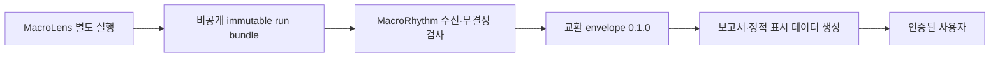

# MacroLens 연동 계약 — R0 설계

상태: 소스 확인 완료 / 교환 규격 `0.1.0` 제안 / exporter·수신기 미구현.

## 1. 확인 근거와 책임 경계

참조: [gnocchi-123/MacroLens main](https://github.com/gnocchi-123/MacroLens).
확인한 커밋: `8f6bfa07ee74587e8ec4fc7e45cc9168895b14cc` (2026-11-08 확인).
이 문서의 사실은 이 커밋에 한정합니다. 움직이는 main 전체의 장기 호환성을 보장하지 않습니다.
참조용 체크아웃은 `/tmp`에 두고 코드·설정·계수는 변경하지 않았습니다.

| 확인한 파일 | 재사용할 기능 / 실제 구조 |
| --- | --- |
| [`ingest.py`](https://github.com/gnocchi-123/MacroLens/blob/8f6bfa07ee74587e8ec4fc7e45cc9168895b14cc/src/macrolens/ingest.py) | FRED/합성 모드 분리, 메타데이터·관측·이용 가능/수집 시각·vintage 저장, 안전한 오류 |
| `snapshots.py`, `features.py` | as_of 이후 자료 배제, 변환·과거 창 표준화, 누락/메타데이터/지연 검사 |
| `scoring.py`, `research.py`, `models/research_v1.json` | 가상/동결 연구 모델 구분, 점수·순위·기여도, 연구 설정 동결 해시 검사 |
| [`storage.py`](https://github.com/gnocchi-123/MacroLens/blob/8f6bfa07ee74587e8ec4fc7e45cc9168895b14cc/src/macrolens/storage.py) | append-only run 저장, COMPLETE·manifest·설정/입력/스냅샷 해시, load_run |
| [`history.py`](https://github.com/gnocchi-123/MacroLens/blob/8f6bfa07ee74587e8ec4fc7e45cc9168895b14cc/src/macrolens/history.py) | 비교 가능성 검사·전후 차이·한국시간 주별 대표·전주/마지막 가용 연결 |
| `cli.py`, `reporting.py` | weekly/show/history/compare/report/replay, 한국어 Markdown 보고서 |

MacroRhythm은 계산을 다시 구현하거나 MacroLens 함수의 내부 형식을 직접 웹 API로 노출하지 않습니다.
MacroLens가 생성한 결과를 검증한 뒤 표시/보고서용으로 투영하는 별도 어댑터를 후속 구현합니다.
MacroLens Markdown은 참고/감사용으로 재사용할 수 있지만 MacroRhythm 보고서의 책임은 MacroRhythm에 있습니다.
M4의 가격·백테스트·포트폴리오 연구와 계수 변경은 이 계약의 범위 밖입니다.
첨부 원문에 따라 **v1(R0~R5)은 네 거시지표 중심이며 섹터 점수·순위는 화면·보고서·설명·이메일에서
제외**합니다. 내부 result 및 합성 fixture의 scores는 원본 불변 보존/호환 검사에만 사용합니다.
M4 검증 이후 R6를 별도 승인하기 전에는 이를 제품에 투영하지 않습니다.

확인한 계산 설정(읽기 전용):

| 지표 | 변환 | 표준화 창 | 관측일 기반 잠정 지연 한도 |
| --- | --- | --- | --- |
| INDPRO | 전년 대비 % | 이전 60개 변환값 | 75일 |
| UNRATE | 3개월 차이의 음수, %p | 이전 60개 변환값 | 75일 |
| CPIAUCSL | 전년 대비 % | 이전 60개 변환값 | 75일 |
| DGS10 | 28일 이전까지의 최근 값과 차이, %p | 이전 1260개 변환값 | 7일 |

DGS10 기준 관측일은 목표일과 7일 이내여야 합니다. 표준편차는 ddof=1, 현재 변환값은 창에서 제외,
z는 ±3으로 제한 후 3으로 나눕니다. 이 규칙을 MacroRhythm에서 바꾸거나 독자적으로 적용하지 않습니다.
현재 설정은 공식 발표 달력이 아니며, 월간 자료가 매주 달라지지 않아도 오류로 단정하지 않습니다.

## 2. MacroRhythm이 읽을 데이터

producer의 실행 디렉터리는 `reports/<run_id>/`입니다. **Git으로 reports를 공유하는 구조가 아닙니다**
(MacroLens `.gitignore` 제외 대상). 별도 비공개 산출물 저장처가 필요합니다.

| 파일 | 소비 목적 / 경계 |
| --- | --- |
| `run.json`, `status.json` | 시작·종료 시각, original/correction/rerun/replay, parent_run_id, 실패/완료 상태 |
| `result.json` | `schema_version=2`; 기준/생성 시각, 모델/엔진, mode/status, 지표·요인·점수·기여도, history, 해시, commit/dirty, 한계 |
| `config.json` | 단위·빈도·계절조정·변환·창·계수·연구 근거/버전; 읽기 전용 |
| `inputs.json` | 실제 선택된 관측 이력과 제외 건수; 향후 시계열 차트의 입력 후보 |
| `snapshot.json` | 입력/스냅샷 검증, 수집 맥락과 감사; raw 응답 포함 가능하므로 브라우저 직접 노출 금지 |
| `manifest.json`, `COMPLETE` | 파일 저장 완료와 SHA-256 검증. COMPLETE는 데이터 정상 표시가 아님 |
| `report.md` | 당시 보고서 재생성/대조 참고; 웹에서는 그대로 신뢰해 HTML 실행하지 않음 |
| `raw/*.json` | producer 감사·보존용. MacroRhythm 표시 데이터로 직접 사용하지 않음 |

대시보드 최신 값은 `result.indicators[SID].raw_value`, 관측일과 시각은 `.observation`,
변환·z·요인은 `transformed_value`, `z`, `value`를 읽습니다. `factors`는 같은 계산의 요인별 뷰입니다.
단위·빈도는 `config.indicators[SID]`에서 읽습니다. `result.json`만으로 장기 시계열 차트를
복원할 수 없으므로 후속 차트 계약은 `inputs.series[SID].observations`의 검증된 투영을 정의해야 합니다.
교환 `0.1.0`은 단일 run 요약만 다루며 시계열/보고서/목록 API가 구현되었다는 뜻은 아닙니다.

## 3. 버전형 JSON 제안

[Schema](contracts/macrolens-run-0.1.0.schema.json)는 JSON Schema Draft 2020-12입니다.

```json
{
  "contract_version": "0.1.0",
  "artifact_kind": "macrolens.run",
  "exported_at": "2026-10-05T00:01:00Z",
  "provenance": {
    "repository": "gnocchi-123/MacroLens",
    "manifest_sha256": "<원본 manifest.json 바이트의 SHA-256 64자리>"
  },
  "result": "<검증한 result.json 객체를 필드 변경 없이 보존>"
}
```

위는 구조 설명용이며 placeholder는 유효한 예제가 아닙니다. 유효한 전체 합성 예제는
[examples 설명](contracts/README.md)에 있습니다. envelope 자체에 API 키/사용자/이메일/로컬 경로를 넣지 않습니다.
`exported_at`은 내보내기 완료 시각, `result.generated_at`은 계산 결과 생성 시각으로 구분합니다.
`result.schema_version`(MacroLens 저장 형식)과 `contract_version`(교환 형식)은 다른 버전입니다.
`result`는 기존 출력 객체를 보존하며, 알려진 핵심 필드를 검사하고 추가 메타데이터는 허용합니다.
R0 schema는 내부 교환용 핵심 구조를 검사하며 upstream 전체 schema나 보안 검증기를 대체하지 않습니다.

호환 범위 제안:

- 첫 소비자는 계약 버전 **정확히 `0.1.0`**, source schema **2**, 엔진 **m2-v1/m3-v1**만 허용.
- 모델은 demo-v1 / macro-sector-hypothesis-v1. m3-v1은 research·frozen·average 표시를 유지.
- M1 schema=1은 source에서 읽기 지원이 있지만 설정/선택 입력이 없으므로 이 교환 계약에서는 거부.
- 미지원 버전은 격리하고 직전 정상 발행본 유지. 임의 추정·다운그레이드·main 자동 추종 금지.
- 필드 의미·단위·필수성·상태·계산 규칙 변경은 계약/호환표와 fixture를 함께 갱신.
  0.x에서는 minor 변경도 깨질 수 있다고 간주, 검증 후 명시적으로 지원 버전을 추가.
- producer 코드는 릴리스/전체 커밋으로 고정하고 결과의 commit/engine/model/config 해시를 기록.
  운영에서는 commit_sha 미상 또는 dirty=true/null 결과를 격리하는 것이 제안 기본값.
- 예제 변경 없이 의미를 덮어쓰지 않음. 확장 승인은 R1 이후 양쪽 호환 테스트로 검토.

## 4. 전달·검증 절차 — 후속 구현

권장 흐름:



1. MacroLens가 COMPLETE를 마지막에 기록한 run만 전달. failed/incomplete는 운영 상태 채널로 분리.
2. 산출물 저장처에서 bundle·전송 체크섬을 받아 임시 디렉터리에서 검증. 접근 인증과 TLS 유지.
   저장처는 인증된 private artifact 또는 private object storage가 후보이며 아직 선택하지 않음.
3. archive/manifest 경로의 절대경로·`..`·symlink·중복 경로·과도한 크기를 거부한 후 읽기.
4. 원본 manifest의 모든 파일 바이트 SHA-256, 필수 파일, run_id, COMPLETE/result/status 일치 확인.
   `storage.load_run` 재사용을 검토하되 status.json 일치 및 경로 방어 등 소비자 검증도 명시적으로 수행.
5. `result.config_hash/input_hash/snapshot_hash`는 MacroLens 방식으로 확인:
   `json.dumps(value, ensure_ascii=False, sort_keys=True, indent=2, allow_nan=False) + "\n"`
   의 UTF-8 SHA-256. 원본 파일 바이트 해시와 혼동하지 않음.
6. envelope JSON Schema + 의미 검사 후 immutable `<run_id>/run-0.1.0.json` 생성.
   envelope 바이트 SHA-256은 별도 전송 메타데이터에 저장(자기 자신을 해싱하는 필드는 두지 않음).
7. 전체 생성·검증 뒤에만 최신 포인터를 원자적으로 교체. 중복 run_id의 다른 해시는 충돌로 거부.

SHA-256은 우발적 손상 확인이며 발행자 인증/서명이 아닙니다. 공급 경로 인증과 최소 권한이 필요합니다.
GitHub 간 접근이 필요하면 저장소별 읽기 권한을 가진 GitHub App의 단기 토큰이 우선 제안입니다.
`GITHUB_TOKEN`이 다른 비공개 저장소까지 읽는다고 가정하지 않습니다. 토큰·키는 해당 저장소의
보안 설정에서 관리하며 Git·JSON·브라우저에 넣지 않습니다. MacroRhythm은 FRED/KIS 키를 필요로 하지 않습니다.

Schema 외 의미 검사(미구현, R1 검수 대상): 중복 JSON key/NaN/Infinity 거부, 유한 수,
시각의 선후·관측의 이용 가능성, 월요일 week_slot 일관성, 지표↔요인 일치, 모델별 섹터 개수/고유성,
`50 + 기여도 합 = 점수`(원본 허용 오차 1e-9), rank/계수/설정 일치,
모드·출처·시점 규칙 일치, history ID/비교 방향·해시 일치. 단순 schema 통과를 게시 허가로 사용하지 않습니다.

## 5. 오류·누락·시점

| 상황 | 소비/표시 제안 |
| --- | --- |
| demo_complete / research_complete | 계산 완료. 실제/합성은 mode로 별도 표시; 투자 검증 성공 아님 |
| held | COMPLETE가 있어도 입력 문제. 각 held.reason과 시각 표시, scores는 빈 배열. 점수·순위 보간 금지 |
| failed / incomplete / unreadable | 정상 데이터로 가져오지 않음. 오류 상태·마지막 성공 시각 알림, 직전 정상본과 구분 |
| 일부 지표 누락 | 필수 네 키를 없애지 말고 held로 표현. 원본에 키 자체가 없으면 계약 위반으로 격리 |
| 부정합·미지원 형식·해시 불일치 | 데이터 사용 중지, 안전한 오류 코드만 기록; 임의 복구/샘플 대체 금지 |
| 주간 작업 실패·지연 | 지난 정상본에 기준일·실패/지연 경고 표시. 최신인 것처럼 날짜만 갱신 금지 |

실행 CLI 종료 코드는 완료 0, 실행 실패 1, 보류/비교 불가 2입니다. 성공 코드만 보거나 COMPLETE만
보면 안 됩니다. 최신 시도 상태와 최신 정상 데이터 포인터를 분리해 held/실패를 숨기지 않습니다.

`published_at`은 실제 모드에서도 null일 수 있습니다. `available_at`은 발표 시각과 같다고 해석하지 않습니다.
실제 현재 수집은 수집 시각부터 이용, 과거 vintage는 미국 중부 전일 기준의 날짜 단위 보수 정책입니다.
`strict_point_in_time=false`와 `point_in_time_status`, `time_policy`, `limitations`, 미검증 표시를 유지합니다.
결측을 0으로 바꾸거나 실제 모드를 합성으로 대체하지 않습니다. 원본 계수/지연 한도도 바꾸지 않습니다.

## 6. 과거 보고서 비교와 정정

우선 원본 `result.history.previous_week`, `last_available`을 그대로 보존합니다. MacroLens는 같은
mode·time_policy·모델 계열에서 현재 실행 시작 전에 완료된 기록 중 주별 마지막 생성 실행을 대표로
선택하고 replay를 제외합니다. 바로 전주가 없으면 마지막 가용 비교로 분리하며 이를 전주라 부르지 않습니다.

비교 가능 조건은 source의 `compare_loaded`를 따릅니다. 같은 model_version/config_hash/engine_version/
mode/time_policy, 같은 지표 출처·변환·창과 유효 점수/기여도 등이 필요합니다.
다르면 `not_comparable`과 사유를 표시하고 수치 변화율을 만들어내지 않습니다.
차이는 **after − before**, 순위 개선은 **before rank − after rank**입니다.
원본은 raw/변환/z/요인/점수/기여도 변화와 실제 시간 간격을 제공합니다.
기여도 변화는 산술 차이이며 발표·개정·기준창 변경의 인과 분해가 아닙니다.

MacroRhythm 보고서는 report_id/revision, week_slot, published_at, source run_id·원본 파일 해시,
비교 대상 run_id/보고서 revision, 계약 버전, 렌더러 버전, 소스 커밋을 묶어 불변 보존하는 것을 제안합니다.
`previous_week`는 producer의 당시 비교이고, **이전에 실제 발행한 보고서**가 선택한 run과 다를 수 있습니다.
두 연결을 구분하고 후자는 별도 필드로 고정합니다. 과거 HTML 재생성 시 최신 데이터로 연결을 재선택하지 않습니다.
정정판은 새 report revision + supersedes 링크로 발행하고 원문은 유지합니다.
새로 수집한 수정 통계가 당시 보고서 입력을 덮어쓰지 않게 합니다. 재현 replay는 원본 history를 유지합니다.
4주/13주 추세·M4 성과 비교는 이번 계약 및 R0 구현 범위 밖입니다.

## 7. 원문 weekly_snapshot_v1과 내부 교환 계약의 관계

원문 5절의 `weekly_snapshot_v1.json`은 **제품 표시용 초안**이며 확인한 MacroLens의 실제 파일명이
아닙니다. R0에서 작성한 envelope `0.1.0`은 내부 원본 교환/감사용입니다. R1은 이 원본을 읽어
별도의 지표 전용 표시 snapshot을 생성하는 어댑터·schema·fixture를 구현해야 합니다.
내부 result를 웹 자산에 그대로 포함하는 방식은 v1 범위와 보안 원칙에 맞지 않습니다.

```text
MacroLens immutable bundle
  -> 내부 run envelope (contract_version=0.1.0, result.schema_version=2)
  -> R1 지표 전용 weekly_snapshot_v1 (별도 schema_version, 아직 미구현)
  -> R2 화면 / R3 보고서·설명 / R4 인증·발행 / R5 이메일
```

다음은 R1 매핑 설계이며 R0에서 이 형식의 실제 데이터를 생성하거나 검증했다는 뜻은 아닙니다.
원문의 `schema_version="1.0"`은 초안 표기이며 R1에서 확정해야 합니다. 내부 계약 버전과 다릅니다.

| 표시 계약의 필드/요구 | 확인한 source 및 제안 매핑 | 주의/추가 검수 |
| --- | --- | --- |
| run_id, model_version | result의 같은 이름 | 계보 기록용. 모델 이름이나 섹터 점수를 거시지표 카드로 노출하지 않음 |
| report_week_kst | result.week_slot | Asia/Seoul 월요일 날짜와 실제 보고서 주차 일치 검사 |
| as_of_utc / generated_at_utc | result.as_of / generated_at을 UTC로 변환 | timezone 포함 ISO-8601을 검증; 원본 offset 문자열을 `_utc`로 이름만 바꾸지 않음 |
| retrieved_at_utc | 지표별 observation.retrieved_at | 지표별 시각이 정본. 최상위 값이 필요하면 유효 지표의 최종 수집 시각(max)으로 정의하고 누락 범위를 별도 표시 |
| published_at_utc | MacroRhythm 발행 단계의 실제 게시 완료 시각 | R1 후보에는 null. observation.published_at(경제자료 발표시각)과 별개 |
| observation_date, raw_value | result.indicators[SID].observation.observation_date / raw_value | 최신 관측일을 오늘 날짜로 바꾸지 않음 |
| raw_unit / 메타데이터 | 검증한 config.indicators[SID].units/frequency/seasonal_adjustment | INDPRO와 CPI의 지수 기준연도도 보존; UNRATE/DGS10은 Percent |
| transformed_value/unit | source transformed_value와 transform, 단위 매핑 | yoy=%; negative_3m 및 difference_28d=%p. 요인 value(-1~1)와 구분 |
| UNRATE 일반 변화 표기 | source negative_3m은 일반 3개월 실업률 차이의 음수 | source 값·변환 식을 유지. 일반 변화값이 필요하면 표시 전용 부호 반전 필드로 분리하고 R1에서 테스트; 재표준화/계수 변경 금지 |
| status=ok/stale/held | 지표 status=valid/held와 안전한 reason·검증된 지연 정보 | source에 stale이라는 enum은 없음. 임의 지연 임계값을 만들지 않으며 원본 지연 사유/시각 기반으로 표시 정책 확정 |
| validation_status=complete/partial/held | 표시용 집계 상태로 별도 정의 | source validation_status는 '미검증 연구용' 문구임. source status/경고/미검증 표시를 따로 보존 |
| previous_report_value, comparison | 직전 실제 발행 보고서에 고정한 해당 지표 | producer previous_week와 다를 수 있음. 비교 가능 조건, 이전 run/revision, 실제 간격 보존 |
| update_kind | 아래 신규·수정·무변동 규칙 | 지표별 비교 가능성과 최초 기준 부재/이력 누락을 처리 |
| source / errors / summary_inputs | source URL, 안전한 상태/사유, 검증된 지표·비교 수치만 허용 목록으로 투영 | raw 응답·키·계수·scores/rank 제외. 자동 설명은 지표 근거만 사용 |
| 차트용 관측 이력 | inputs.series[SID].observations의 시점/메타데이터 검증된 투영 | source 값·vintage·시각 보존. 긴 시계열의 별도 자산/스키마는 R1에서 정의 |

표시 상태 제안: 네 지표가 모두 유효하면 complete, 일부만 유효하면 partial, 유효한 지표가 없으면 held.
partial에서도 문제 지표의 수치는 null/사유로 표시하고 정상 지표만 구분해 표시합니다.
source 전체 status=held와 점수 보류는 그대로 보존하며 표시 집계를 producer 계산 완료로 오인하지 않습니다.
계약/해시 불일치나 failed/incomplete는 partial로 살리지 않고 격리합니다.
partial 보고서 게시 허용 여부는 발행 정책으로 별도 결정하며, R0에서 허용했다고 간주하지 않습니다.

원문 update_kind의 판정 설계:

- 기준은 **직전 발행판**. 동일 mode·지표 정의/단위/시점 정책과 비교 가능한 입력이 필요합니다.
- observation_date가 증가하면 new_observation. 과거 행도 바뀌었다면 별도 revision 경고를 함께 남김.
- observation_date가 같고 raw_value가 달라지면 revision. 경제기관의 정식 정정 발표를 확인했다는 뜻은 아님.
- 관측일·원자료 값이 같으면 unchanged(원자료 기준). vintage/수집 시각만 바뀌었다고 신규 관측이라 부르지 않음.
  변환값이나 과거 행은 별도로 달라질 수 있으므로 변경 사실/불확실성을 함께 표시.
- 처음 발행해 비교 기준이 없거나 지표가 보류, 시점이 역행, 비교 불가능하면 unavailable + 이유.
- 실제 발표시각을 모르는 경우 '신규 발표 없음'을 단정하지 않고
  **'새 관측값 반영 없음'**처럼 관측 가능한 사실로 설명. 과거 이력 수정은 현재/이전 입력 이력으로 별도 대조.

v1 검수에 신규 관측·같은 관측일 수정·무변동·보류의 구별, 단위/부호, 원본 수치 일치,
과거판 불변, 섹터 필드 비노출을 포함합니다. R6 확장 없이는 11개 섹터 점수를 요약 입력으로 쓰지 않습니다.

## 8. 추가 확인 필요

producer 실행 담당과 고정 버전, exporter 소유권, 내부→지표 전용 표시 매핑은 R1에서 확정/검증합니다.
운영 실행에서 어떤 source 모델을 사용하는지는 계보 재현을 위한 선택이며 섹터 점수 표시 승인과 다릅니다.
비공개 bundle 전달/보관 기간, 자료 cutoff, 향후 스키마 확장 등은 관련 구현 시 결정하며
호스팅 계정·실키 부재는 합성 입력 R1 개발을 막지 않습니다. M4 작업 브랜치는 운영 의존성에 넣지 않습니다.
실제 FRED/KIS 수집·인증 전달·배포 호환성은 이번에 검증하지 않았습니다.
